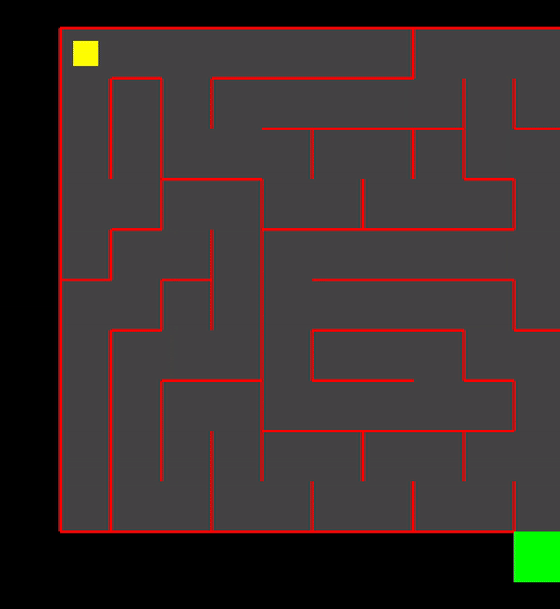

[](https://github.com/sashaster/AI-Escape/actions/workflows/build-linux.yml) [](https://github.com/sashaster/AI-Escape/actions/workflows/build-mac.yml)
# Maze RL with PPO

<sub>Teaching an AI to escape mazes</sub>



The goal is for an agent to explore a maze and find the exit.
The agent is built in PyTorch and trained with [Proximal Policy Optimization (PPO)](https://spinningup.openai.com/en/latest/algorithms/ppo.html) and the maze environment is built in C++ with OpenGL.
Both of them communicate over a UDP socket: the environment sends observations and the agent replies with actions.
The agent reached exit in 100 out of 100 test episodes.
---
### Building
```bash
cmake -B build -DCMAKE_BUILD_TYPE=Release && cmake --build build --config Release
```
### Running
```bash
./build/bin/AI_Escape & uv run --directory RL src/agent.py test
```


